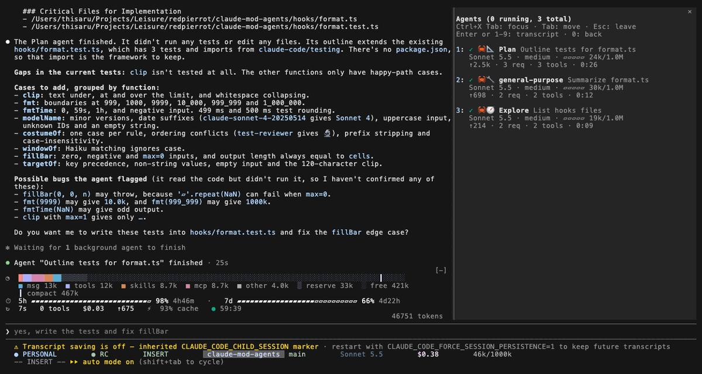
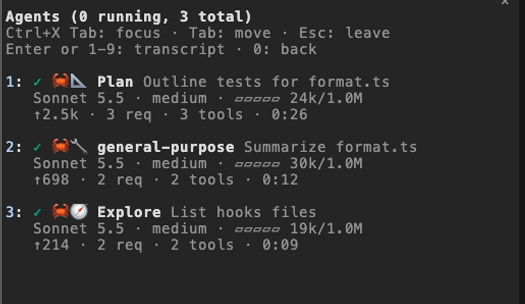

# 🦀 agent-crabs — a subagent pane for Claude Code

A docked **Agents** pane for [Claude Code](https://claude.com/claude-code). See every subagent your session spawns at a glance: what it is doing, how much context it has used, and how long it has been running, without scrolling through the transcript.



## Features

- **Live status per agent**: running (●), done (✓) or failed (✗), newest first, last 100, scrollable.
- **A crab costume per agent type**: 🧭 Explore, 📐 Plan, 🔧 general-purpose, 🔬 review, 🔒 security, 🧪 test, 📖 docs, 🎨 design, 🍴 fork. Anything else wears the plain 🦀.
- **Everything that matters on two lines**: type, label, model and effort, a context bar with used/window size, output tokens, requests, tool calls and elapsed time.
- **Latest tool call** shown while the agent runs, such as `↳ Bash run the tests`.
- **Opens by itself** when the first subagent starts. `/agents-pane` toggles it.
- **Transcript viewer**: jump into any subagent's transcript from the pane and back again (see below).
- **Fallback rows**: when the pane is closed or the terminal is too narrow, one row per running agent appears above the prompt instead.
- **Private by design**: no network, no files, no processes. See [Privacy and security](#privacy-and-security).



## View a subagent's transcript

The pane uses Claude Code's `$.ui.view` mod API (Claude Code 2.1.300 or later), which shows an agent's transcript in the main view.

- Give the pane the keyboard (Ctrl+X then Tab, or click it). The pane shows the keys in two dim lines: Tab moves, Esc leaves. Press `1` to `9` to open the transcript of the agent on that row (1 is the top, newest row), or Tab to a row and press Enter. Rows beyond nine open with Tab and Enter.
- `/agents-pane view <n>` does the same from the prompt (`n` counts from the top of the pane), and `/agents-pane view <id-prefix>` matches an agent id (three characters or more).
- While an agent is in view, the pane marks it `◀ viewing` and shows a back row. Press `0` in the pane, or run `/agents-pane back`.

Limits: Claude Code only lets a mod switch the view while it answers your own input (a key press, a click or a command), so nothing switches on its own. The engine forgets a finished agent a short while after it ends, and then its transcript cannot be opened; the mod says so in a message and changes nothing. An agent continued from a resumed session is listed once it does work, and opens like any other while the engine tracks it.

## Option

`rows` (`/config`, or `pluginConfigs.agent-crabs.options.rows`): `auto` (default) draws the rows above the prompt only while the pane is not showing, `off` never, `always` also while the pane is open.

## Install

Requires Claude Code 2.1.300 or later, in a terminal session.

In a Claude Code session:

```
/plugin install agent-crabs --marketplace redpierrot/claude-mod-agents
```

Answer `y` to add the marketplace, then pick a scope. From a shell:

```sh
claude plugin install agent-crabs --marketplace redpierrot/claude-mod-agents
```

If the pane does not appear, run `/reload-plugins`, and check that `/plugin` lists `agent-crabs` as enabled. After an update, run `/reload-plugins` again.

To try it from a checkout instead:

```sh
claude --plugin-dir /path/to/claude-mod-agents
```

## Privacy and security

A mod runs inside the Claude Code process with your permissions and no sandbox. This one:

- reads subagent events (type, label, model, token counts, tool names and a short target such as a file name or a command description) and keeps them in memory for the session;
- makes no network calls, registers no tools, spawns no processes, reads and writes no files;
- registers one slash command, `/agents-pane`, and calls `$.ui.view` only from a key press or that command.

Read `hooks/register.tsx` before you install it.

## Develop

```sh
claude plugin validate . --strict
claude plugin test .
```

## License

[MIT](LICENSE)
